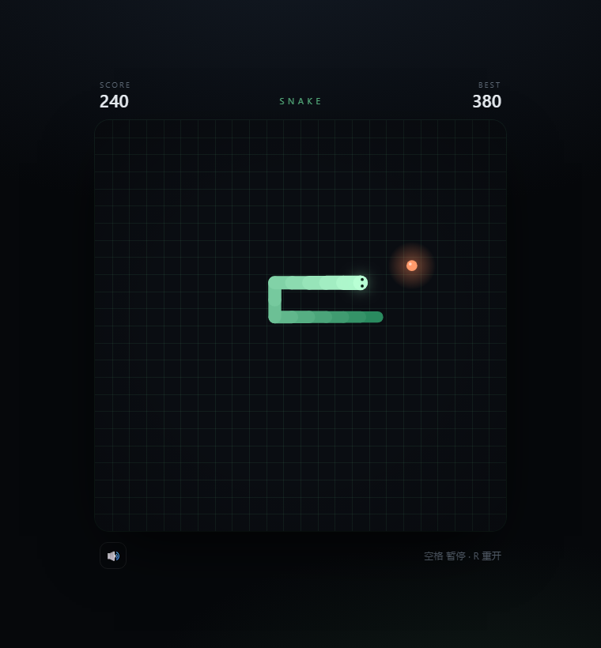

# Snake

**A precise, dependency-free Snake game.** No build step, no frameworks, no tracking — one `index.html` and six small modules.

[**▶ Play it live**](https://yooo1206.github.io/snake/) · [Report a bug](../../issues)



---

## Why this exists

Most browser Snake games are a canvas and a `setInterval`. This one is built like production software:

- **The rules are a pure state machine.** `js/game.js` knows nothing about the DOM, so it is fully unit-tested.
- **The loop is fixed-timestep with interpolated rendering.** Speed changes never desync the simulation, and motion is smooth at any refresh rate.
- **Input is buffered.** Two turns can be queued, so a fast double-tap never gets swallowed.

## Features

| | |
| :-- | :-- |
| 🎮 **Controls** | Arrow keys, WASD, swipe on touch devices |
| 🧠 **Input buffer** | Up to 2 queued turns, reversals rejected |
| ✨ **Rendering** | DPR-aware canvas, interpolated movement, particles, screen shake |
| 🔊 **Audio** | Procedurally synthesised with WebAudio — no asset files |
| 💾 **Persistence** | Best score in `localStorage` |
| 📱 **Responsive** | Fills any viewport, safe-area aware |
| ♿ **Accessibility** | Keyboard-only play, visible focus, `prefers-reduced-motion` respected |
| 🧪 **Tests** | 12 unit tests, zero dependencies |
| 📦 **Zero runtime deps** | No npm install required to play |

## Play locally

ES modules cannot be loaded from `file://`, so serve the folder:

```bash
python -m http.server 8123
# then open http://127.0.0.1:8123
```

Or with Node:

```bash
npx serve .
```

## Controls

| Action | Keys |
| :-- | :-- |
| Move | `↑` `↓` `←` `→` or `W` `A` `S` `D` |
| Start / pause | `Space` |
| Restart | `R` |
| Mute | `M` |
| Move (touch) | Swipe on the board |

## Architecture

```
index.html          markup and overlays
css/style.css       layout, typography, responsive rules
js/config.js        every tunable number in one frozen object
js/game.js          pure rules: movement, collision, growth, scoring
js/renderer.js      canvas drawing, interpolation, particles, shake
js/audio.js         WebAudio synthesis with a lazy AudioContext
js/input.js         keyboard + swipe, with cleanup
js/main.js          glue: fixed-timestep loop, HUD, overlays
test/game.test.js   12 tests against the pure state machine
```

### The loop

```js
accumulator += dt;
while (accumulator >= game.interval && game.status === 'running') {
  accumulator -= game.interval;
  game.step();
}
const alpha = accumulator / game.interval; // 0..1 between two cells
renderer.render(game, alpha, now);
```

The simulation advances on whole cells; the renderer draws between the previous and current cell using `alpha`. That is why the snake glides instead of hopping, and why eating food can speed the game up without breaking anything.

### Why the rules live apart

`SnakeGame` exposes `step()`, `queueDirection()`, `drainEvents()`. The renderer only reads. That split is what makes the tests possible — they assert collision, growth, buffering and the speed floor without a browser.

## Development

```bash
node --test          # run the suite
node --test --watch  # watch mode
```

`tools/preview.html` is a screenshot harness that renders a mid-game board with a fixed seed — it is what regenerates `docs/preview.png`.

## 中文说明

一个零依赖的贪吃蛇：没有构建步骤、没有框架，打开即可玩。

- **规则与渲染分离**：`js/game.js` 是纯状态机，不碰 DOM，因此可以被完整单元测试。
- **固定步长 + 插值渲染**：逻辑按整格推进，画面在两格之间插值，所以蛇是滑行而不是跳格；加速也不会让模拟跑偏。
- **输入缓冲**：最多缓存两次转向，快速连按不会丢指令，反向输入会被拒绝。

本地运行需要起一个静态服务器（ES 模块不支持 `file://`）：

```bash
python -m http.server 8123
```

## License

[MIT](LICENSE) © 2026 Yooo1206
